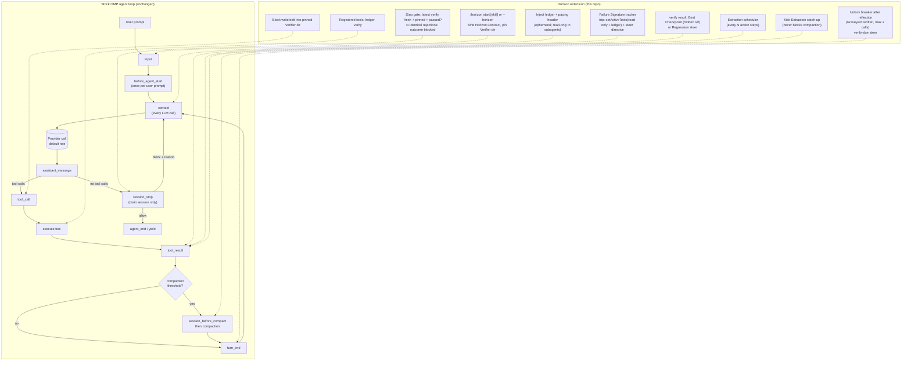
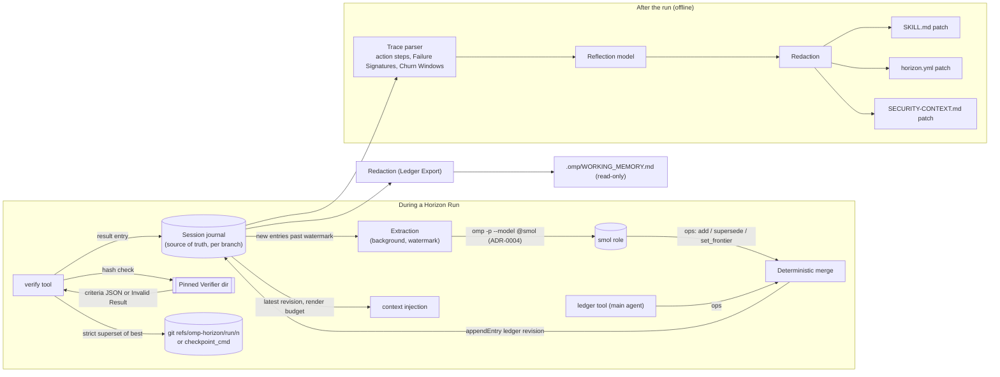

# Architecture: Horizon engine on the stock OMP loop

The engine is an extension plugin (ADR-0001). It never replaces a stage of OMP's agent loop; it attaches to documented hooks (dotted edges) and registers two tools, `ledger` and `verify`, which stay inactive until a Horizon Run needs them. Terms are defined in [CONTEXT.md](../CONTEXT.md). Outside a Horizon Run every hook is a no-op.

## Hook attachment

## State and data flow

## Stock OMP vs Horizon Run

| Concern | Stock OMP | Horizon Run |
|---|---|---|
| Memory across compaction | Summary compaction, or experimental notes mode (model-maintained `context_notes`) | Harness-extracted Working Memory Ledger in the journal, injected on every LLM call |
| Tool thrashing | Nothing deterministic (advisor is optional, advisory) | Circuit Breaker keyed on Failure Signature; tools locked for one reflection call |
| Completion | Model decides; `session_stop` has no handlers by default | Stop gate on a fresh, pinned, passing Verifier result; `blocked` outcome on stall |
| Workspace/environment state | None (`checkpoint`/`rewind` are conversation-only) | Best Checkpoint as hidden git ref or `checkpoint_cmd`; Regression alerts |
| Pacing | Goal mode token/time accounting (interactive only) | Ephemeral pacing header: LLM calls, elapsed, context %, Verifier state, Best Checkpoint |
| Learning across runs | Experimental autolearn | trace-reflect: Churn Windows to reviewable, redacted patches split by scope |
| Model routing | Unchanged | Unchanged: no `setModel` calls (ADR-0003 covers interplay with the pre-flight router) |
